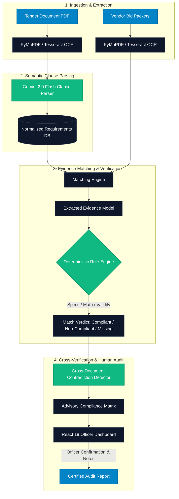

<div align="center">

# 🏛️ TenderCheck

### **Autonomous Verification & AI-Assisted Compliance Engine for Enterprise & Government Tenders**

[](https://github.com/eswarprasadreddy/tendercheck/stargazers)
[](https://fastapi.tiangolo.com)
[](https://react.dev)
[](https://ai.google.dev)
[](https://www.postgresql.org/)
[](./LICENSE)

<br/>

<p align="center">
  <b>TenderCheck</b> transforms dense, multi-hundred-page public tender RFPs and complex vendor bid packages into structured, cross-audited compliance determinations in seconds. Built on a <b>Human-in-the-Loop</b> architecture, TenderCheck combines Gemini 2.0 Flash intelligence with deterministic Python verification engines and cross-document discrepancy auditing.
</p>

[Explore Documentation](#-architecture--engine-design) • [Quickstart (Docker)](#-quick-start) • [Interactive Flow](#-workflow-pipeline) • [Sector Schema](#-pluggable-sector-rules) • [API Reference](#-api-specification)

<br/>

```
╔═══════════════════════════════════════════════════════════════════════════════════════════════════╗
║                                                                                                   ║
║   Tender PDF (GeM / RFP) ──► PyMuPDF + OCR ──► Gemini 2.0 Flash (Clause Extractor)                ║
║                                                          │                                        ║
║                                                          ▼                                        ║
║   Vendor Submissions     ──► Evidence Parser ──► Deterministic Verification Rules                 ║
║   (P&L, ISO, Spec Sheets)                                │                                        ║
║                                                          ▼                                        ║
║                                           Cross-Doc Contradiction Engine                          ║
║                                                          │                                        ║
║                                                          ▼                                        ║
║                                       Officer Confirmation Audit Trail                            ║
║                                                                                                   ║
╚═══════════════════════════════════════════════════════════════════════════════════════════════════╝
```

</div>

---

## ⚡ Highlights

- **⚡ Hybrid Text & Vision Ingestion**: Seamlessly processes native digital PDFs and low-resolution scanned photocopies via `PyMuPDF` with automatic `Tesseract OCR` fallback.
- **🧠 Zero-Hallucination Clause Parser**: Extracts structured requirements across Technical Specifications, Financial Minimums, Certifications, Legal Covenants, and Delivery Schedules with schema-validated Pydantic models.
- **🛡️ Deterministic Rule Verification**: Eliminates LLM flakiness in critical qualification criteria. Numbers, turnover thresholds, validity dates, and mathematical comparisons execute in sandboxed, test-backed Python rule sets.
- **🔍 Multi-Document Contradiction Engine**: Catches conflicting claims across multiple vendor submissions (e.g., claiming 32 GB RAM in the compliance matrix while attaching spec sheets stating 16 GB, or contradictory annual turnover across balance sheets).
- **⚖️ Human-in-the-Loop Officer Audit Trail**: The AI is purely advisory. Every qualification verdict links to exact line citations, page coordinates, and requires an authenticated procurement officer's sign-off before official report generation.
- **🔌 Pluggable Sector Intelligence**: Ships out-of-the-box with GeM-compliant IT Hardware & Electronics rules (BIS, Make-in-India Class I/II, MSME Udyam exemptions, ISO 9001/27001), extensible to Defense, Civil Works, and Healthcare.

---

## 🏗️ Architecture & Engine Design

TenderCheck operates on an asymmetric verification paradigm: **LLMs extract and normalize unstructured text; deterministic mathematical engines verify compliance.**



---

## 📊 Comparison Matrix

| Capability | Traditional Manual Review | Generic LLM Chatbot | **TenderCheck** |
| :--- | :---: | :---: | :---: |
| **Audit Defense & Citation Tracking** | ❌ Manual bookmarking | ❌ Vague references | **✅ Page-level, snippet-bound citations** |
| **Numeric & Formula Precision** | ⚠️ Human error prone | ❌ Prone to math hallucinations | **✅ Sandboxed Python deterministic logic** |
| **Cross-Document Discrepancy Flagging**| ❌ Misses subtle conflicts | ⚠️ Limited context window | **✅ Automated Multi-File Contradiction Service** |
| **Procurement Exemption Handling** | ⚠️ Complex manual check | ❌ Irregular compliance | **✅ Baked-in MSME, Startup & GeM policies** |
| **Legal Non-Repudiation** | ⚠️ Disjointed signatures | ❌ Cannot be certified | **✅ Authenticated Officer Review & Audit Log** |

---

## 🛠️ Tech Stack

<div align="center">

| Layer | Technologies | Purpose |
| :--- | :--- | :--- |
| **Frontend** | React 19, Vite 8, Lucide React, Modern CSS System | Real-time Officer Workbench, interactive evidence viewer, dark-mode first design |
| **Backend API** | FastAPI 0.115, Pydantic v2, Uvicorn, Python 3.10+ | Asynchronous RESTful core, OpenAPI documentation, robust schema validation |
| **Intelligence** | Google Gemini 2.0 Flash (`google-genai` SDK) | Ultra-fast clause extraction, evidence structuring, and semantic similarity |
| **Document Processing**| PyMuPDF (Fitz 1.25), Tesseract OCR, Pillow | High-speed PDF rendering, vectorized text parsing, raster OCR fallback |
| **Persistence** | PostgreSQL 16 Alpine, SQLAlchemy 2.0 (Asyncpg), Alembic | Fully async relational storage with migrations, JSONB audit logs |
| **DevOps** | Docker, Docker Compose, Pytest AsyncIO, Oxlint | Single-command containerized spinup and rigorous automated testing |

</div>

---

## 🚀 Quick Start

### Option 1: Docker Compose (Recommended)

Get the complete system running in under 2 minutes:

```bash
# 1. Clone the repository
git clone https://github.com/eswarprasadreddy/tendercheck.git
cd tendercheck

# 2. Configure environment
cp backend/.env.example backend/.env
# Open backend/.env and add your GEMINI_API_KEY

# 3. Spin up PostgreSQL, FastAPI Backend, and Services
docker-compose up --build
```

- **Frontend Application**: `http://localhost:5173`
- **FastAPI OpenAPI Swagger**: `http://localhost:8000/docs`
- **API Health Check**: `http://localhost:8000/health`

---

### Option 2: Local Development Setup

#### Prerequisites
- Python 3.10 or higher
- Node.js 18+ & npm
- PostgreSQL 14+ running locally (or via Docker)
- Tesseract OCR (`tesseract` in system PATH)

#### 1. Backend Setup

```bash
cd backend

# Create virtual environment
python -m venv .venv
# Linux/macOS: source .venv/bin/activate
# Windows PowerShell:
.venv\Scripts\Activate.ps1

# Install core dependencies with testing suite
pip install -e ".[test]"

# Configure environment variables
copy .env.example .env
# Edit .env with your PostgreSQL credentials & GEMINI_API_KEY

# Run database migrations
alembic upgrade head

# Start FastAPI development server
uvicorn app.main:app --host 0.0.0.0 --port 8000 --reload
```

#### 2. Frontend Setup

```bash
cd ../frontend

# Install dependencies
npm install

# Launch Vite development server
npm run dev
```

---

## 🧪 Demo Pipeline & Synthetic Evaluation

TenderCheck includes an automated end-to-end evaluation runner with synthetic GeM IT Hardware tenders and multi-vendor submissions (Vendor A: compliant, Vendor B: disqualified with spec mismatches and expired certificates):

```bash
# From workspace root
python demo_data/run_demo_pipeline.py
```

<details>
<summary><b>View Sample Terminal Output</b></summary>

```text
================================================================================
 TenderCheck Demo Pipeline: End-to-End Evaluation
================================================================================
[+] Ingesting Tender: tender_gem_2026_it_hardware.pdf (3 pages)
[+] Extracted 12 requirements across Technical, Financial, Certifications, Experience
[+] Processing Vendor A: TechCorp Solutions Ltd.
    - Verified ISO 9001:2015 [Valid through 2027-11-15] -> COMPLIANT
    - Verified Annual Turnover [INR 45.20 Cr >= INR 25.00 Cr] -> COMPLIANT
    - Verified RAM Spec [32 GB >= 16 GB] -> COMPLIANT
    - Cross-Doc Contradictions Found: 0
    - Advisory Overall Verdict: QUALIFIED (100% Match)

[+] Processing Vendor B: Apex Infotech Pvt. Ltd.
    - Verified ISO 9001:2015 [EXPIRED on 2024-03-01] -> NON_COMPLIANT
    - Verified Display Resolution [Claimed: FHD 1080p, Attached: HD 720p] -> CONTRADICTION
    - Cross-Doc Contradictions Found: 2 (High Severity)
    - Advisory Overall Verdict: DISQUALIFIED
```
</details>

---

## 📁 Repository Structure

```
tendercheck/
├── backend/
│   ├── app/
│   │   ├── api/v1/                # REST endpoints (Tenders, Documents, Matching, Reports)
│   │   ├── llm/                   # Gemini 2.0 Flash prompt templates & parsers
│   │   ├── models/                # SQLAlchemy 2.0 Async ORM models
│   │   ├── schemas/               # Pydantic validation schemas (Evidence, Match, Verdict)
│   │   ├── sectors/               # Pluggable sector rules (e.g., it_hardware.json)
│   │   ├── services/
│   │   │   ├── pdf_extractor.py          # PyMuPDF + Tesseract OCR hybrid extractor
│   │   │   ├── requirement_parser.py     # LLM clause normalization service
│   │   │   ├── matching_engine.py        # Vectorized evidence-requirement matcher
│   │   │   ├── verification_engine.py    # Sandboxed deterministic Python rule engine
│   │   │   ├── contradiction_service.py  # Cross-document claim discrepancy detector
│   │   │   └── report_service.py         # Audit report & signed officer verdict pipeline
│   │   ├── config.py              # Dynamic settings & environment manager
│   │   ├── database.py            # Async engine and session factory
│   │   └── main.py                # FastAPI lifecycle & application assembly
│   ├── alembic/                   # Database version migration scripts
│   ├── tests/                     # Test suite (Unit, Mock, Evidence Rules, Integration)
│   └── pyproject.toml             # Python packaging & dependencies
├── frontend/
│   ├── src/
│   │   ├── components/
│   │   │   ├── RequirementsScreen.jsx   # Parsed clause editor & rule customizer
│   │   │   ├── UploadScreen.jsx         # Tender & multi-vendor dropzone with OCR status
│   │   │   ├── ComplianceScreen.jsx     # Side-by-side compliance grid with live filters
│   │   │   ├── EvidencePanel.jsx        # Page-anchored snippet & citation viewer
│   │   │   └── LoginScreen.jsx          # Secure procurement officer sign-in
│   │   ├── api.js                       # Axios/fetch communication layer
│   │   ├── App.jsx                      # App root router & state transitions
│   │   └── index.css                    # Modern CSS design system
│   └── package.json
├── demo_data/                     # Synthetic test PDFs & pipeline verification runners
├── docker-compose.yml             # Full-stack orchestrator (FastAPI + Postgres + Vite)
└── README.md
```

---

## 📡 API Specification

| Method | Endpoint | Description | Key Parameters |
| :--- | :--- | :--- | :--- |
| `POST` | `/api/v1/tenders/upload` | Ingests Tender PDF, runs OCR if needed, extracts requirements via Gemini | `file: UploadFile`, `title: str`, `sector: str` |
| `GET` | `/api/v1/tenders/{id}/requirements` | Fetches parsed requirements list with categories and operators | `tender_id: UUID` |
| `PUT` | `/api/v1/tenders/{id}/requirements/{req_id}`| Customizes or overrides requirement rules before evaluation | `RequirementUpdateSchema` |
| `POST` | `/api/v1/vendor-docs/upload` | Ingests vendor bid packets (Certificates, P&L, Specs) | `file: UploadFile`, `vendor_name: str` |
| `POST` | `/api/v1/matching/run/{tender_id}/{vendor}` | Triggers matching, deterministic rules, & contradiction scanner | `tender_id`, `vendor_name` |
| `GET` | `/api/v1/reports/{tender_id}/{vendor}` | Returns full compliance evaluation matrix with citations | `tender_id`, `vendor_name` |
| `POST` | `/api/v1/reports/{report_id}/confirm` | Human Officer signs off, approves, or overrides verdicts | `officer_id`, `signature`, `notes` |

---

## 🔌 Pluggable Sector Rules

TenderCheck is engineered for rapid domain adaptation. Adding a new procurement sector (e.g., Medical Devices, Solar EPC, Heavy Construction) requires simply creating a declarative JSON schema under `backend/app/sectors/`:

```json
{
  "sector_id": "solar_epc",
  "sector_name": "Solar PV Power Plant Procurement",
  "known_certificates": [
    {"key": "mnre_approval", "name": "MNRE Enlistment ALMM", "has_expiry": true},
    {"key": "iec_61215",     "name": "IEC 61215 Terrestrial PV Modules", "has_expiry": true}
  ],
  "known_specs": [
    {"key": "module_efficiency_pct", "name": "Module Efficiency", "unit": "%", "default_operator": ">="},
    {"key": "inverter_capacity_kw",  "name": "Inverter Capacity",  "unit": "kW", "default_operator": ">="}
  ],
  "known_financial_fields": [
    {"key": "annual_turnover", "name": "Average Annual Turnover", "unit": "INR"}
  ]
}
```

---

## 🛡️ Security, Privacy & Compliance

- **No Training on Sensitive Documents**: Queries sent to Gemini Flash are processed with enterprise zero-retention / zero-training flags.
- **Local OCR & Parsing Options**: Extractors can operate completely air-gapped on private intranets with local LLM gateways (Ollama/vLLM) if required.
- **Immutable Audit Logging**: Every manual officer verdict override is recorded in PostgreSQL with timestamp, user ID, previous verdict, and required justification note.

---

## 🤝 Contributing

Contributions are what make the open-source community an incredible place to learn, inspire, and create. Any contributions you make are **greatly appreciated**.

1. Fork the Project
2. Create your Feature Branch (`git checkout -b feature/AmazingFeature`)
3. Commit your Changes (`git commit -m 'feat: Add deterministic solar battery rule parser'`)
4. Push to the Branch (`git push origin feature/AmazingFeature`)
5. Open a Pull Request

---

## 📄 License

Distributed under the **MIT License**. See [`LICENSE`](./LICENSE) for more information.

---

<div align="center">

Built with precision by [Eswar Prasad Reddy](https://github.com/eswarprasadreddy) and open-source contributors.

⭐ **Star us on GitHub if TenderCheck helps your procurement workflow!**

</div>
