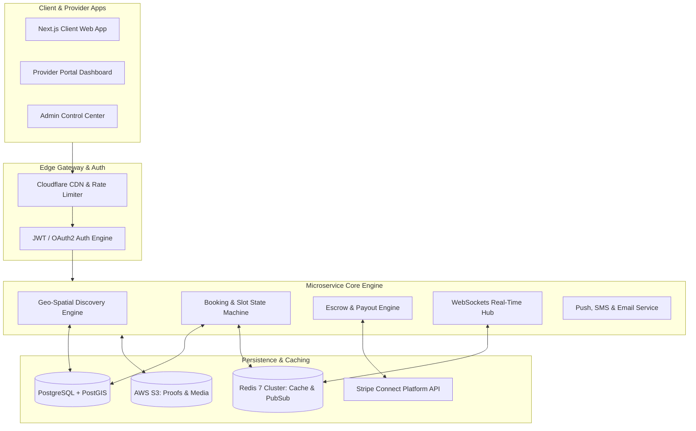
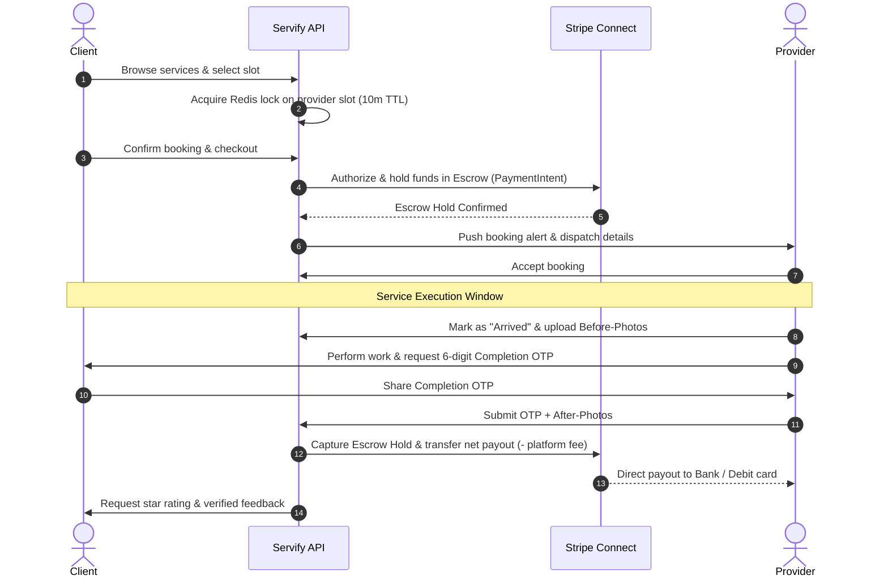

<div align="center">

# 🛒 Servify — Next-Gen On-Demand Service Marketplace

### **Enterprise-Grade Distributed Marketplace for Verified Professional Services, Real-Time Bookings, and Secure Escrow Settlements**

[](https://github.com/eswarprasadreddy/service-marketplace/stargazers)
[](https://nextjs.org/)
[](https://www.typescriptlang.org/)
[](https://postgis.net/)
[](https://stripe.com)
[](https://www.docker.com/)
[](./LICENSE)

<br/>

<p align="center">
  <b>Servify</b> is an end-to-end, multi-sided marketplace platform connecting vetted service professionals (home repairs, technical consultation, wellness, creative freelance) with high-intent clients. Featuring millisecond geo-spatial discovery, slot-level availability scheduling, two-sided escrow payment safety, WebSockets messaging, and an automated dispute resolution engine.
</p>

[Explore Documentation](#-architecture--lifecycle-design) • [Quick Start](#-quick-start) • [Escrow Payment Flow](#-escrow--booking-lifecycle) • [Data Model](#-database-schema--data-models) • [API Specification](#-restful--websocket-api-reference)

<br/>

```
╔═══════════════════════════════════════════════════════════════════════════════════════════════════╗
║                                                                                                   ║
║   Client Search ──► PostGIS Spatial Radius ──► Real-Time Provider Calendar Matching               ║
║                                                          │                                        ║
║                                                          ▼                                        ║
║   Booking Lock  ──► Stripe Connect Escrow Hold ──► WebSockets In-App Chat & Media Sync            ║
║                                                          │                                        ║
║                                                          ▼                                        ║
║   Service Done  ──► OTP Verification / Proof ──► Dual Review & Automated Payout Release           ║
║                                                                                                   ║
╚═══════════════════════════════════════════════════════════════════════════════════════════════════╝
```

</div>

---

## ⚡ Highlights

- 📍 **Sub-50ms Geo-Spatial Search**: High-performance spatial indexing powered by `PostGIS` and spatial bounding boxes to match clients with nearby verified professionals within dynamic travel radiuses.
- 💳 **Two-Sided Escrow Protection**: Full Stripe Connect integration holding funds securely in escrow until service completion and customer OTP/signature confirmation, completely protecting both parties.
- 📅 **Dynamic Slot & Buffer Scheduling**: Instant synchronization preventing double-booking, factoring in provider service durations, transit buffers, and recurring business hours.
- 💬 **Live In-App Chat & Media Verification**: Built-in real-time WebSockets communication with end-to-end image attachments for before/after job proof and scoping.
- 🛡️ **Automated Dispute Tribunal**: Structured dispute resolution workflow with milestone locks, evidence arbitration, and automated partial refund allocations.
- 📊 **Provider Analytics & CRM Suite**: Professional portal for earnings projections, route optimization, tax 1099/GST reporting, and customer retention metrics.
- 🔒 **Zero-Trust Identity & Background Vetting**: Multi-tier provider onboarding incorporating government ID verification, license checks, and automated review fraud heuristics.

---

## 🏗️ Architecture & Lifecycle Design

Servify is built with a decoupled event-driven architecture designed to scale seamlessly across peak booking spikes:



---

## 🔄 Escrow & Booking Lifecycle

Here is the exact state machine that powers dispute-free transactions on the platform:



---

## 📊 Comparison: Why Servify?

| Feature | Legacy Classifieds (Craigslist) | Traditional Gig Apps | **Servify** |
| :--- | :---: | :---: | :---: |
| **Payment Protection** | ❌ None (Cash on hand) | ⚠️ Opaque fees & delays | **✅ Transparent Stripe Escrow with immediate release** |
| **Location Precision** | ❌ Zip-code level | ⚠️ Flat city coverage | **✅ PostGIS Sub-kilometer radius & live routing** |
| **Availability Integrity** | ❌ Manual phone calls | ⚠️ Frequent overlap | **✅ Real-time distributed atomic calendar locks** |
| **Job Validation** | ❌ Unverified claims | ⚠️ Basic review stars | **✅ Cryptographic OTP + Before/After media audit** |
| **Provider Economics** | ❌ High platform cut (25-40%)| ⚠️ Opaque tipping | **✅ Custom tiered take-rates (8-15%) with instant cashout** |

---

## 🛠️ Technology Stack

<div align="center">

| Domain | Technology | Details |
| :--- | :--- | :--- |
| **Frontend Framework** | **Next.js 15 (App Router)** | React 19, Server Components, Fast Refresh, Zero-CLS |
| **Styling & Components**| **TailwindCSS & Shadcn UI** | Accessible Radix UI primitives, Lucide icons, Dark/Light modes |
| **Backend & Routing** | **Node.js / Express or FastAPI** | Modular controller pattern, Async request pooling, OpenAPI v3 |
| **Spatial Database** | **PostgreSQL 16 + PostGIS** | Spatial indexes (`ST_DWithin`, `ST_MakePoint`), ACID compliance |
| **Caching & Pub/Sub** | **Redis 7** | Distributed slot locking (`Redlock`), message broker, rate limiting |
| **Payments & Escrow** | **Stripe Connect Custom/Express**| Multi-party payouts, split settlements, automated refunds |
| **Real-Time Layer** | **Socket.io / Native WebSockets** | Bi-directional messaging, presence detection, typing indicators |
| **Media Storage** | **AWS S3 / Cloudflare R2** | Presigned secure upload URLs, WebP compression pipeline |

</div>

---

## 🚀 Quick Start

### 1. Docker Compose (One-Click)

The easiest way to bootstrap the complete database, Redis cluster, backend, and frontend locally:

```bash
# 1. Clone the repository
git clone https://github.com/eswarprasadreddy/service-marketplace.git
cd service-marketplace

# 2. Copy and populate environment variables
cp .env.example .env

# 3. Spin up services
docker-compose up -d --build
```

Access the development endpoints:
- **Web App**: `http://localhost:3000`
- **REST API & Swagger Docs**: `http://localhost:4000/api/docs`
- **Database Explorer (Prisma / Adminer)**: `http://localhost:8080`

---

### 2. Manual Local Setup

#### Prerequisites
- Node.js 18.x or 20.x
- PostgreSQL with PostGIS extension enabled
- Redis server running on `localhost:6379`
- Stripe developer test keys

#### Backend Setup
```bash
cd backend
npm install
cp .env.example .env

# Run database migrations & seed categories
npx prisma migrate dev --name init
npx prisma db seed

# Start server
npm run dev
```

#### Frontend Setup
```bash
cd ../frontend
npm install
cp .env.example .env.local

# Launch Next.js application
npm run dev
```

---

## 🗄️ Database Schema & Data Models

Servify leverages a relational schema optimized for high concurrent write throughput and spatial queries:

```prisma
// Sample Core Schema (Prisma)
model User {
  id            String         @id @default(uuid())
  email         String         @unique
  fullName      String
  role          UserRole       @default(CLIENT) // CLIENT, PROVIDER, ADMIN
  phone         String?
  avatarUrl     String?
  createdAt     DateTime       @default(now())
  
  // Relations
  providerProfile ProviderProfile?
  clientBookings  Booking[]      @relation("ClientBookings")
  reviewsGiven    Review[]       @relation("ReviewsGiven")
}

model ProviderProfile {
  id              String         @id @default(uuid())
  userId          String         @unique
  user            User           @relation(fields: [userId], references: [id])
  bio             String?
  hourlyRate      Decimal        @db.Decimal(10, 2)
  serviceRadiusKm Float          @default(25.0)
  latitude        Float
  longitude       Float
  isVerified      Boolean        @default(false)
  stripeAccountId String?
  services        ServiceItem[]
  bookings        Booking[]      @relation("ProviderBookings")
}

model Booking {
  id              String         @id @default(uuid())
  clientId        String
  providerId      String
  status          BookingStatus  @default(PENDING) // PENDING, ACCEPTED, IN_PROGRESS, COMPLETED, DISPUTED
  scheduledStart  DateTime
  scheduledEnd    DateTime
  totalAmount     Decimal        @db.Decimal(10, 2)
  escrowPaymentId String?
  completionOtp   String?
  createdAt       DateTime       @default(now())
}
```

---

## 📡 RESTful & WebSocket API Reference

### Core Endpoints

| Method | Route | Description | Auth Required |
| :--- | :--- | :--- | :---: |
| `GET` | `/api/v1/services/search` | Radius search using `lat`, `lng`, `radiusKm`, `category` | No |
| `POST` | `/api/v1/bookings/draft` | Creates temporary reservation with 10-minute Redis lock | Yes |
| `POST` | `/api/v1/payments/create-intent` | Initiates Stripe Connect escrow PaymentIntent | Yes |
| `POST` | `/api/v1/bookings/{id}/verify-otp` | Validates provider completion OTP and triggers payout | Yes (Provider) |
| `POST` | `/api/v1/disputes/raise` | Freezes transaction funds and opens evidence docket | Yes |
| `GET` | `/api/v1/providers/analytics` | Payout history, rating distributions, and upcoming slots | Yes (Provider) |

### WebSocket Events (`/ws/marketplace`)

```typescript
// Incoming Events (Client -> Server)
socket.emit("join_booking_room", { bookingId: "bkg_98234" });
socket.emit("send_message", { bookingId: "bkg_98234", text: "I have arrived at the gate." });

// Broadcast Events (Server -> Client)
socket.on("provider_location_update", (coords: { lat: number; lng: number }) => { ... });
socket.on("booking_status_changed", (data: { newStatus: "IN_PROGRESS" | "COMPLETED" }) => { ... });
```

---

## 📁 Repository Structure

```
service-marketplace/
├── frontend/                     # Next.js 15 client & provider portals
│   ├── src/
│   │   ├── app/                  # App Router pages (Home, Search, Booking, Dashboard)
│   │   ├── components/           # UI components (Shadcn UI, MapView, BookingCalendar)
│   │   ├── hooks/                # Custom React hooks (useGeolocation, useSocket, useEscrow)
│   │   └── lib/                  # Utilities, formatters, and API clients
├── backend/                      # Node.js / Express / Prisma API service
│   ├── src/
│   │   ├── controllers/          # Business logic handlers (Bookings, Search, Payments)
│   │   ├── middlewares/          # JWT Auth, Rate limiter, Role-Based Access Control
│   │   ├── services/             # Stripe Connect, PostGIS Queries, Socket Manager
│   │   └── prisma/               # Schema definitions, migrations, and seed data
├── docker/                       # Dockerfiles and Postgres/Redis configs
├── docker-compose.yml             # Orchestration for frontend, backend, DB & cache
└── README.md
```

---

## 🗺️ Roadmap & Future Enhancements

- [x] PostGIS geo-radius search with interactive MapLibre/Mapbox view
- [x] Stripe Connect Express custom onboarding & escrow retention
- [x] In-app WebSockets instant messaging with media attachment support
- [ ] AI-Powered job scoping assistant (Estimating job duration & costs from photos)
- [ ] Multi-currency international settlements
- [ ] Native iOS and Android companion apps with React Native / Expo

---

## 🤝 Contributing

Contributions are warmly welcomed! Please read our [Contributing Guidelines](./CONTRIBUTING.md) to get started.

1. Fork the Project
2. Create your Feature Branch (`git checkout -b feature/SmartRouteOptimizer`)
3. Commit your Changes (`git commit -m 'feat: Add travel-time buffer calculation'`)
4. Push to the Branch (`git push origin feature/SmartRouteOptimizer`)
5. Open a Pull Request

---

## 📄 License

Distributed under the **MIT License**. See [`LICENSE`](./LICENSE) for more details.

---

<div align="center">

Crafted with excellence by [Eswar Prasad Reddy](https://github.com/eswarprasadreddy) and community contributors.

⭐ **If you find this project inspiring, please give it a star!**

</div>
